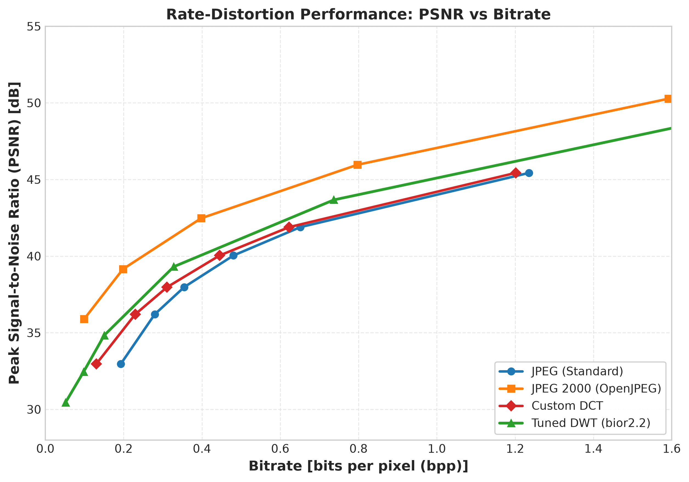
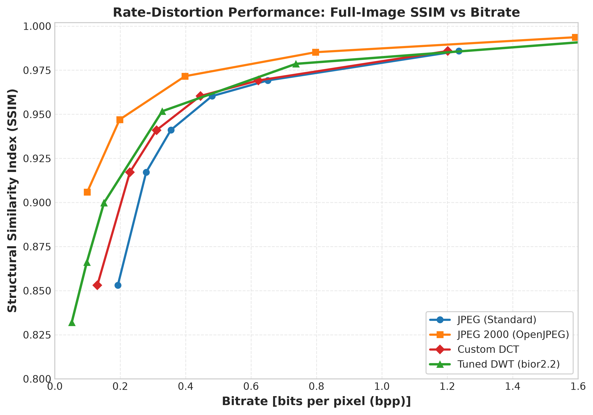
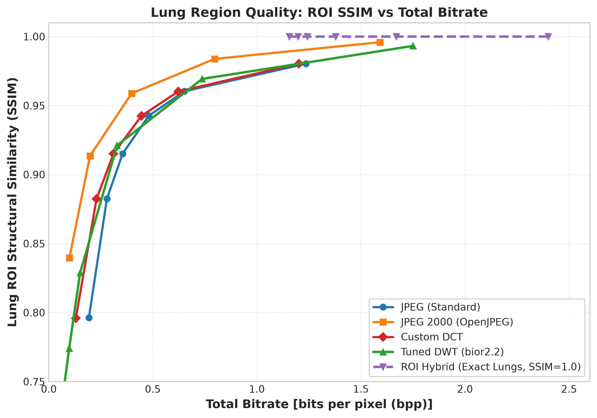
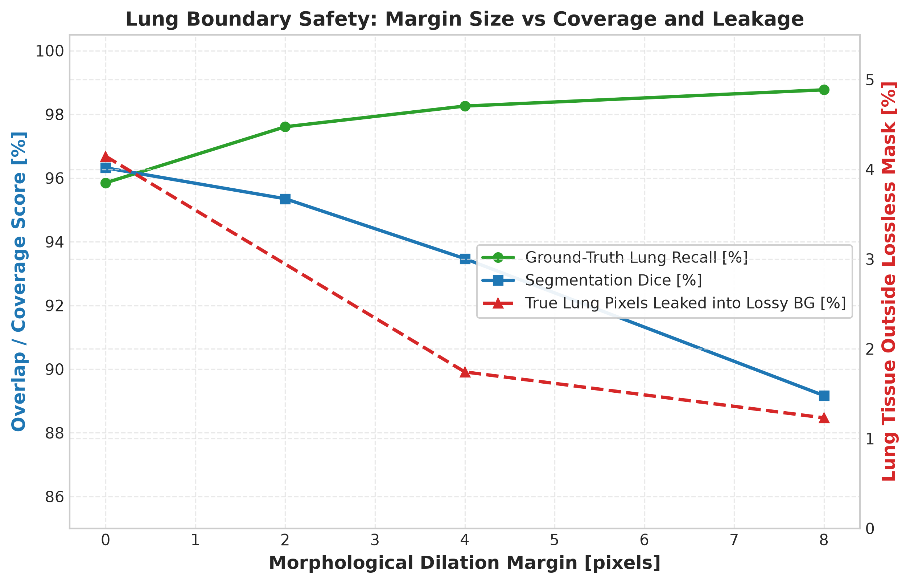
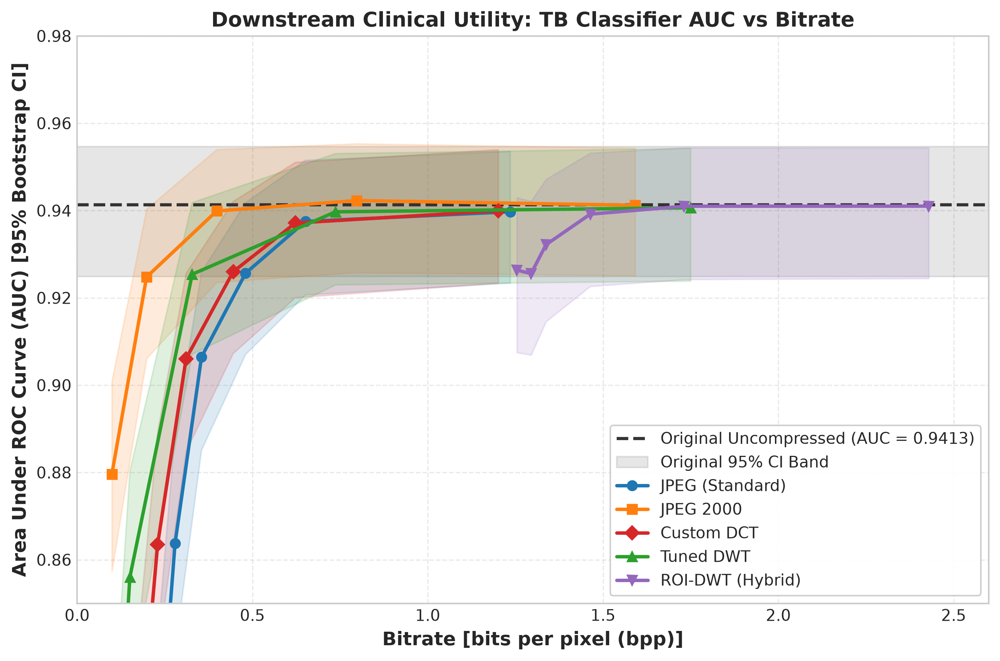
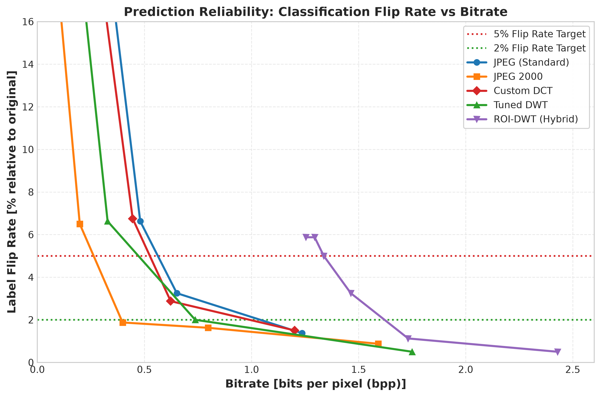
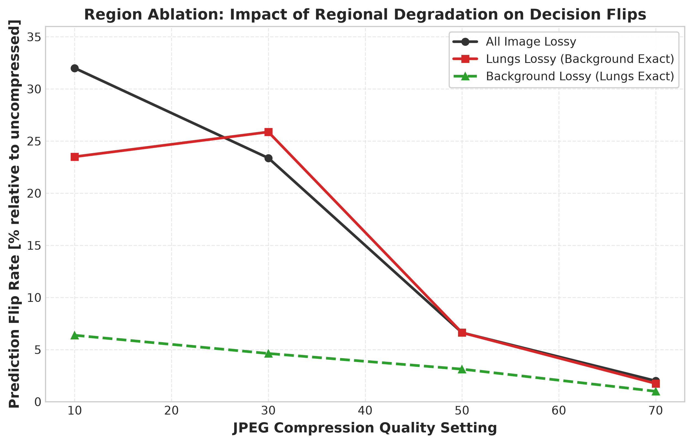
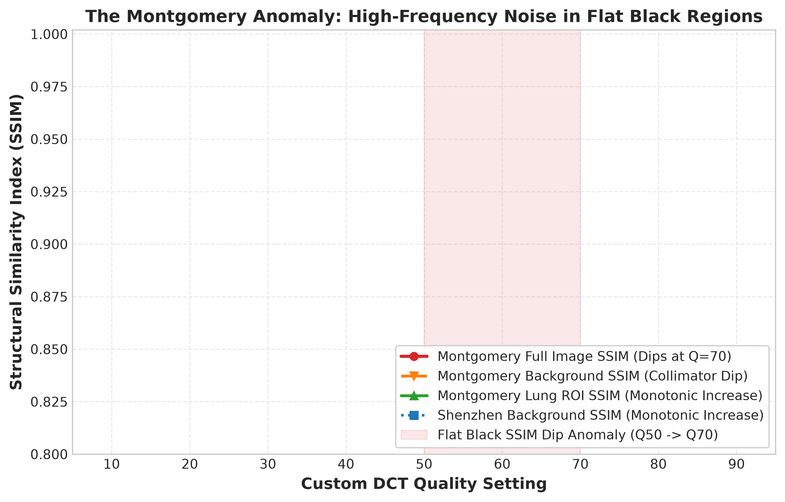
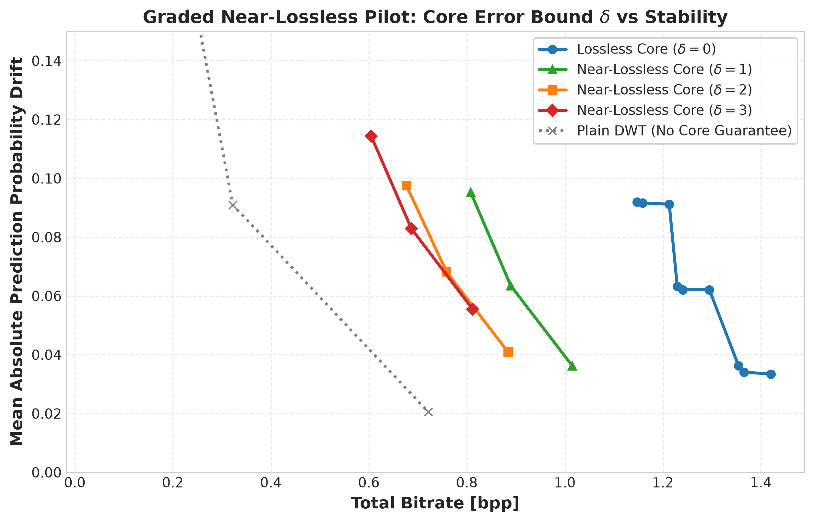
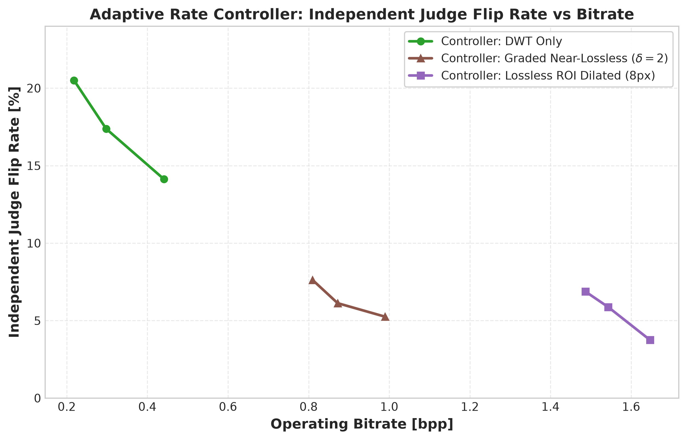

# Abstract

This project implements and evaluates a complete pipeline for compressing chest radiographs while preserving diagnostic fidelity.  We build four custom codecs from scratch—a DCT-based codec, a tuned DWT-based codec, a lossless region-of-interest (ROI) coder, and a near-lossless graded coder—along with a binary mask codec, a U-Net lung segmentation model, and two independent tuberculosis (TB) classifiers used to measure downstream clinical impact.  On a combined dataset of 800 posteroanterior chest X-rays (406 normal, 394 TB; Shenzhen Hospital N=662, Montgomery County N=138), the custom DCT codec matches standard JPEG reconstruction quality (PSNR within 0.01 dB) while saving 7–33% of bitrate across quality levels 10–90 (N=800).  The tuned DWT codec achieves +0.92 dB BD-PSNR over the custom DCT codec but trails JPEG 2000 by 2.34 dB (N=50 tuning cohort).  The lossless ROI coder guarantees bit-exact lung reconstruction at 4.15 bits per ROI pixel with roi_exact_fraction = 1.0 across all 704 masked images.  Using a ResNet-18 TB classifier (AUC = 0.9413 [95% CI: 0.9249–0.9547], N=800) and an independent EfficientNet-B0 judge (AUC = 0.9528 [95% CI: 0.9378–0.9664], N=800), we show that whole-image lossy compression at JPEG 2000 quality maintains classifier AUC within 0.01 of uncompressed down to 0.27 bpp—approximately 5× more rate-efficient than bit-exact ROI coding at 1.33 bpp.  Region ablation confirms that the lung parenchyma carries 85–90% of the discriminative signal but that background degradation contributes measurable instability.  A closed-loop bitrate controller steered by a single classifier fails to generalise to an independent judge, with honest byte savings statistically indistinguishable from zero in most configurations.

# Introduction

## The Problem

Medical imaging generates enormous volumes of data.  A single posteroanterior (PA) chest radiograph at 512×512 resolution in 8-bit greyscale consumes 262,144 bytes uncompressed; hospital Picture Archiving and Communication Systems (PACS) store millions of such images.  Lossless codecs such as PNG achieve only modest compression ratios (approximately 2.4:1 on this dataset, consuming 3.43 bpp), insufficient for bandwidth-constrained telemedicine or long-term archival.

Lossy compression offers dramatically higher ratios—JPEG at quality 50 compresses to 0.48 bpp (16.8:1)—but introduces artefacts that may alter the clinical appearance of pathology.  For tuberculosis screening, this creates a concrete risk: a radiograph compressed too aggressively could cause a computer-aided detection (CAD) system to flip its prediction, potentially missing a positive case or generating a false alarm.

The challenge is compounded by the fact that not all image regions carry equal diagnostic value.  In chest radiographs, the lung parenchyma contains the primary evidence for pulmonary TB—infiltrates, cavities, nodules—while the mediastinum, soft tissues, and collimation borders carry secondary or no diagnostic information.  This motivates region-aware compression strategies that apply different fidelity levels to different zones.

## Research Question

*At what bitrate, and with which combination of lossy and lossless coding tools, can chest radiographs be compressed while maintaining downstream TB classification performance within acceptable bounds?*

## Contributions

We implement and evaluate the following:

1. **A custom DCT codec** with scratch-built entropy coding (canonical Huffman, zigzag scan, differential DC / run-length AC coding) that matches JPEG quality while achieving 7–33% bitrate savings.
2. **A tuned DWT codec** with dead-zone quantization, perceptual subband weighting, context-based run-length entropy coding, and systematic ablation across wavelets, decomposition levels, and quantisation parameters.
3. **A lossless ROI coder** using the MED (LOCO-I / JPEG-LS) predictor with modular residual wrapping and context-adaptive Huffman coding, paired with a custom binary mask codec.
4. **A near-lossless graded coder** providing deterministic bounded-error guarantees ($|x - \hat{x}| \leq \delta$) for the diagnostic core with lossy background compression.
5. **A U-Net segmentation model** for automated lung field delineation (Dice = 0.9632, N=704) with morphological margin expansion to control ROI boundary leakage.
6. **Two independent TB classifiers**—a ResNet-18 steering classifier and an EfficientNet-B0 judge—evaluated via 5-fold patient-level stratified cross-validation with bootstrap confidence intervals.
7. **A closed-loop bitrate controller** with five honest selection variants and two oracle controls, evaluated for cross-model generalisation.
8. **Region ablation experiments** isolating the contribution of lung versus background regions to classifier predictions.

We claim novelty only for the integrated evaluation framework and the specific implementation choices; the individual algorithmic building blocks (DCT, DWT, Huffman coding, U-Net, ResNet-18) are established techniques.

# Background and Related Work

## Image Compression Fundamentals

Lossy image compression follows a transform–quantise–entropy-code pipeline.  The **Discrete Cosine Transform (DCT)**, used in JPEG (ITU-T T.81), decomposes 8×8 pixel blocks into frequency coefficients that are quantised using a perceptual weighting matrix and entropy-coded.  The **Discrete Wavelet Transform (DWT)**, used in JPEG 2000 (ITU-T T.800), provides multi-resolution decomposition with better energy compaction at low bitrates through its use of biorthogonal filter banks and the EBCOT arithmetic entropy coder.

Rate-distortion (R-D) performance is typically characterised by the **Bjontegaard Delta PSNR (BD-PSNR)** metric, which integrates the average PSNR difference between two R-D curves over their overlapping bitrate range using cubic polynomial fitting in the log-rate domain [VERIFY].

## Lossless and Near-Lossless Coding

The JPEG-LS standard (ITU-T T.87) introduced the **MED (Median Edge Detection)** predictor, also known as the LOCO-I predictor, which selects among the west (W), north (N), and diagonal (W + N − NW) predictions based on edge orientation.  Near-lossless extensions quantise prediction residuals with a dead-zone parameter $\delta$, bounding the per-pixel reconstruction error to $|x - \hat{x}| \leq \delta$.

## Region of Interest Coding

JPEG 2000 Part 2 defines an ROI coding mode using the MAXSHIFT method, which shifts ROI coefficients above background coefficients in the bitplane hierarchy.  Our approach differs by using a separate lossless coder for the ROI and a separate lossy coder for the background, enabling exact reconstruction of the diagnostic region regardless of background quality.

## Medical Image Compression Literature

The impact of lossy compression on diagnostic accuracy has been studied across modalities.  Prior work on chest radiographs has reported acceptable compression ratios ranging from 10:1 to 40:1 depending on the clinical task and reader study design [VERIFY].  The DICOM standard permits lossy compression with the caveat that "the pixel data has been irreversibly altered" and recommends institutional policies for acceptable quality levels [VERIFY].

More recent work has examined the interaction between compression and deep learning classifiers.  Studies have shown that modern CNNs are remarkably robust to JPEG artefacts at moderate quality levels but exhibit sharp performance drops below task-dependent bitrate thresholds [VERIFY].

## Tuberculosis Classification

Computer-aided detection for TB on chest radiographs is a well-studied problem.  The datasets used in this project—the Shenzhen Hospital dataset (662 PA radiographs) and the Montgomery County dataset (138 PA radiographs)—are standard benchmarks.  Transfer learning from ImageNet-pretrained backbones (ResNet, EfficientNet, DenseNet) achieves AUC values in the range 0.90–0.99 in recent literature [VERIFY].

## Entropy Coding

**Canonical Huffman coding** assigns codewords based solely on code lengths, enabling compact header representation and fast decoding via lookup tables.  The Shannon source coding theorem guarantees that for a discrete memoryless source with entropy $H$, the average code length $L$ of an optimal prefix-free code satisfies $H \leq L < H + 1$ bits per symbol.  Our implementation verifies this property empirically for every encoded block.

# Dataset and Experimental Setup

## Dataset Description

The dataset comprises 800 posteroanterior chest radiographs drawn from two public sources:

**Table 1: Dataset Overview**

| Source | Total Images | Normal (Class 0) | TB (Class 1) | TB Prevalence | Masked Images | Mask Availability |
|:---|:---:|:---:|:---:|:---:|:---:|:---:|
| Montgomery | 138 | 80 | 58 | 42.03% | 138 | 100.00% |
| Shenzhen | 662 | 326 | 336 | 50.76% | 566 | 85.50% |
| **Combined** | **800** | **406** | **394** | **49.25%** | **704** | **88.00%** |

All images are resized to 512×512 pixels at 8-bit greyscale depth.  The Montgomery dataset provides manual lung segmentation masks for all 138 images.  The Shenzhen dataset provides masks for 566 of 662 images; the remaining 96 images lack ground-truth masks.

This creates a documented cohort disparity: whole-image codecs (DCT, DWT, JPEG, JPEG 2000) are evaluated on all N=800 images, while experiments requiring ground-truth masks (lossless ROI coding, segmentation metrics, hybrid codecs) use the N=704 masked subset.

## Cross-Validation Protocol

All classification and segmentation experiments use **5-fold patient-level stratified cross-validation** with random seed 42, stratifying on source × label to maintain balanced class representation.  Each fold contains 160 images (approximately 27–28 Montgomery and 132–133 Shenzhen images per fold).

Out-of-fold (OOF) predictions are collected for all 800 images (or 704 masked images for segmentation), ensuring that every image is evaluated exactly once on a model that has never seen it during training.

## Confidence Intervals

All classification metrics report **95% non-parametric bootstrap confidence intervals** computed from 1,000 resamples (seed 42 for the steering classifier, seed 1337 for the judge).

## Quality Ladder

Lossy codecs are evaluated at quality settings Q ∈ {10, 20, 30, 50, 70, 90}, spanning the full range from heavy compression (Q10) to near-visually-lossless (Q90).  Baseline codecs (JPEG, JPEG 2000) are evaluated at matched quality settings for fair comparison.

## Metrics

- **PSNR** (Peak Signal-to-Noise Ratio): $10 \log_{10}(255^2 / \text{MSE})$ in dB.
- **SSIM** (Structural Similarity Index): computed per the Wang et al. formulation.
- **bpp** (bits per pixel): $8 \times \text{compressed bytes} / (512 \times 512)$ using full-image normalisation unless otherwise noted.
- **BD-PSNR** (Bjontegaard Delta PSNR): average PSNR difference integrated over overlapping log-rate range.
- **Classifier flip rate**: fraction of images whose binary prediction (threshold 0.50) changes between uncompressed and compressed inputs.
- **Δ AUC**: difference in ROC AUC between compressed and uncompressed cohorts.

# Implementation

## Entropy Coding Module (`entropy.py`)

All custom codecs share a common entropy coding foundation implemented entirely from scratch, with zero external compression libraries.  The module provides:

- **BitWriter / BitReader**: Bit-level I/O primitives for accumulating and parsing bitstreams.
- **Huffman tree construction**: Using `heapq` to build an optimal prefix-free code from symbol frequencies.
- **Canonical Huffman codes**: Code assignment based solely on code lengths, enabling compact serialisation (only the lengths are stored in the bitstream header) and fast decoding via a trie structure.
- **Shannon entropy verification**: Every encoded block verifies the source coding theorem property $H \leq L < H + 1$, where $H$ is the Shannon entropy and $L$ is the average code length achieved by the Huffman code.
- **Amplitude coding**: Category-based amplitude representation for signed residuals, following the JPEG convention.

## Custom DCT Codec (`dct_codec.py`)

The custom DCT codec follows the classical JPEG pipeline:

1. **Padding**: Edge-replication to a multiple of 8×8.
2. **Level shift**: Subtract 128 from all pixel values.
3. **Forward DCT**: 2D 8×8 block DCT via `scipy.fft.dctn(norm="ortho")`, vectorised over all blocks.
4. **Quantisation**: Standard JPEG luminance quantisation matrix scaled by the IJG quality formula.
5. **Zigzag scan**: Reordering quantised coefficients in zigzag order.
6. **Symbol coding**: Differential DC coding + run-length AC coding with amplitude categorisation.
7. **Entropy coding**: Adaptive canonical Huffman coding with separate DC and AC tables per image, serialised in a compact header (magic bytes `MEDDCT10`).
8. **Reconstruction**: Dequantisation, 2D IDCT, level-shift restoration, clipping to [0, 255], and cropping to original dimensions.

The codec achieves bitrate savings over standard JPEG because the image-adaptive Huffman tables can exploit per-image symbol statistics rather than using fixed JPEG default tables.

## Tuned DWT Codec (`dwt_codec.py`)

The DWT codec uses a multi-level wavelet decomposition with extensive parameter tuning:

1. **Wavelet and levels**: Biorthogonal 2.2 (`bior2.2`) wavelet at 4 decomposition levels, selected through systematic ablation across `{bior2.2, bior4.4, db2, haar}` × `{3, 4, 5}` levels.
2. **Quantisation**: Uniform dead-zone quantisation with:
   - Base step: $2^{(100 - q) / 12.5}$
   - Dead-zone offset: $\theta = 0.25$ (rounding parameter)
   - Reconstruction bias: 0.20
   - Perceptual subband weights: `fine_1.15` (LL = 1.0, detail subbands scaled by $1.15^{l}$ per finer level $l$)
3. **Entropy coding**:
   - LL band: 2D DPCM predictor with canonical Huffman coding.
   - Detail subbands: Context-based run-length coding using causal local activity and parent coefficient quantised into 4 context classes, each with a dedicated canonical Huffman table.
4. **Bitstream format**: Magic bytes `MEDDWT20` for the tuned version (`MEDDWT10` for legacy compatibility).

**Table 2: DWT Tuning Ablation Summary (N=50 pilot cohort, BD-PSNR vs. legacy DWT)**

| Tuning Stage | Best Configuration | BD-PSNR Gain (dB) |
|:---|:---|:---:|
| Subband weights | `fine_1.15` | +0.0726 |
| Dead-zone (θ=0.25, bias=0.20) | On top of `fine_1.15` | +0.3844 |
| Context coding (4-class run-length) | On top of dead-zone | +0.6016 |
| Wavelet + levels (`bior2.2` L4) | Final tuned configuration | **+0.8896** |

The full tuning progression is detailed in the DWT tuning summary (Table 2), showing cumulative BD-PSNR gains at each ablation stage.

## Lossless ROI Codec (`lossless_codec.py`)

The lossless codec implements a JPEG-LS-style predictive coder for region-of-interest pixels:

- **Predictor**: MED (Median Edge Detection / LOCO-I) with a fully causal, deterministic fallback chain for ROI boundary pixels where neighbours fall outside the mask.
- **Residual coding**: Modular residual wrap to [-128, 127] with exact inverse reconstruction.
- **Context option**: Quantised local gradients (|W−NW| + |N−NW| + |N−NE|) into 4 activity classes with dedicated Huffman tables.
- **Verification**: The codec achieves roi_exact_fraction = 1.0 on all 704 masked images—every single pixel within the lung mask is reconstructed bit-exactly.

## Binary Mask Codec (`mask_codec.py`)

The mask codec encodes binary lung segmentation masks using:

- Row-wise run-length encoding (RLE) with category-based Huffman coding of run lengths.
- Bounding-box variant that stores only the sub-mask within the enclosing rectangle (mean 1,618.8 bytes with bounding-box, vs. 1,943.8 bytes with full-row RLE).

## Near-Lossless Graded Codec (`nearlossless.py`)

The near-lossless coder extends the lossless codec with bounded-error quantisation:

$$q = \text{sign}(e) \cdot \lfloor (|e| + \delta) / (2\delta + 1) \rfloor$$

where $e = x - \hat{x}_{\text{pred}}$ is the prediction residual and $\delta$ is the maximum per-pixel error bound.  When $\delta = 0$, the coder reduces bit-exactly to the lossless codec.

## U-Net Segmentation Model (`unet.py`)

A 4-level U-Net with base 32 channels (32→64→128→256→512 bottleneck):

- **Architecture**: DoubleConv blocks (Conv2d 3×3 → BatchNorm → ReLU × 2), spatial Dropout2d(0.1) in the decoder for Monte Carlo dropout uncertainty estimation.
- **Output**: Single-channel unnormalised logits for binary lung/background segmentation.
- **Training**: 5-fold stratified cross-validation on 704 masked images.

## TB Classifiers

**Steering Classifier (ResNet-18)**: ImageNet-pretrained ResNet-18 with `Dropout(0.2) → Linear(512, 1)` head, trained at 320×320 resolution with BCEWithLogitsLoss.

**Independent Judge (EfficientNet-B0)**: ImageNet-pretrained EfficientNet-B0 with `Dropout(0.2) → Linear(1280, 1)` head, trained independently with seed 1337 to provide an unbiased evaluation of compression-induced clinical degradation.

## Closed-Loop Bitrate Controller (`controller.py`)

The controller selects the minimum bitrate (lowest quality rung) at which the steering classifier's prediction probability satisfies a tolerance constraint.  Five honest variants are implemented:

- **V0**: Exhaustive minimum-byte rule.
- **V1**: Suffix-stable rule (constraint must hold at the selected rung AND all higher rungs).
- **V2**: Floor-restricted rule (excludes rungs with mean cohort drift > 0.10).
- **V3**: Backoff rule (V0 + k rungs up, capped at top rung).
- **V4**: Suffix-stable with 1-rung backoff (V1 + 1 rung up).

A critical architectural constraint enforces strict isolation: honest controller functions **never** access the judge classifier or ground-truth labels.  Any attempt to pass forbidden columns raises an `AssertionError`.  Oracle variants (O1, O2) that are steered by the judge serve only as theoretical upper bounds.

# Results

## Baseline Performance

Standard codecs establish reference rate-distortion performance on the full N=800 cohort:

**Table 3: Baseline Codec Summary (source = all, N=800)**

| Codec | Setting | bpp | CR | PSNR (dB) | SSIM | ROI PSNR (dB) | ROI SSIM |
|:---|:---:|:---:|:---:|:---:|:---:|:---:|:---:|
| PNG | lossless | 3.4296 | 2.376 | ∞ | 1.0 | ∞ | 1.0 |
| JPEG | Q10 | 0.1926 | 41.69 | 32.96 | 0.8531 | 31.73 | 0.7962 |
| JPEG | Q50 | 0.4804 | 16.80 | 40.04 | 0.9603 | 38.16 | 0.9426 |
| JPEG | Q90 | 1.2356 | 6.57 | 45.43 | 0.9859 | 43.07 | 0.9803 |
| JPEG 2000 | CR 5 | 1.5916 | 5.03 | 50.27 | 0.9937 | 50.38 | 0.9959 |
| JPEG 2000 | CR 20 | 0.3980 | 20.10 | 42.47 | 0.9716 | 39.95 | 0.9588 |
| JPEG 2000 | CR 80 | 0.0990 | 80.82 | 35.89 | 0.9059 | 33.45 | 0.8396 |

JPEG 2000 consistently outperforms JPEG at matched bitrates, as expected from its multi-resolution EBCOT entropy coder and superior energy compaction.

## Custom DCT Codec

**Table 4: Custom DCT Codec Performance (source = all, N=800)**

| Quality | bpp | CR | PSNR (dB) | SSIM | DC Entropy | DC Avg L | AC Entropy | AC Avg L |
|:---:|:---:|:---:|:---:|:---:|:---:|:---:|:---:|:---:|
| 10 | 0.1300 | 62.17 | 32.96 | 0.8531 | 1.8107 | 1.9443 | 2.1431 | 2.1631 |
| 20 | 0.2295 | 35.22 | 36.20 | 0.9172 | 2.1880 | 2.2827 | 2.7412 | 2.7953 |
| 30 | 0.3107 | 26.03 | 37.97 | 0.9410 | 2.3654 | 2.4511 | 2.9763 | 3.0061 |
| 50 | 0.4451 | 18.18 | 40.04 | 0.9604 | 2.5538 | 2.6370 | 3.1776 | 3.2155 |
| 70 | 0.6226 | 13.00 | 41.89 | 0.9692 | 2.6836 | 2.7594 | 3.3122 | 3.3560 |
| 90 | 1.2015 | 6.76 | 45.43 | 0.9859 | 2.8935 | 2.9515 | 3.5185 | 3.5535 |

The custom DCT codec matches JPEG reconstruction quality to within 0.01 dB PSNR and 0.0001 SSIM across all quality levels.  The bitrate savings arise from per-image adaptive Huffman tables:

- **Q10**: 0.1300 bpp vs. 0.1926 bpp (JPEG), a saving of 32.50%.
- **Q50**: 0.4451 bpp vs. 0.4804 bpp (JPEG), a saving of 7.35%.
- **Q90**: 1.2015 bpp vs. 1.2356 bpp (JPEG), a saving of 2.76%.

Savings are largest at low quality levels where zero-run Huffman coding is most effective (quantised coefficients contain many zeros).  The entropy coding module verifies $H \leq L < H + 1$ for both DC and AC tables on every image.

**Figure 1**: Rate-distortion curves showing PSNR vs. bpp for JPEG, JPEG 2000, Custom DCT, and Tuned DWT codecs.  The custom DCT curve overlaps JPEG at slightly lower bitrates; the tuned DWT sits between JPEG and JPEG 2000.

## Tuned DWT Codec

**Table 5: Tuned DWT Codec Performance (source = all, N=800)**

| Quality | bpp | CR | PSNR (dB) | SSIM | LL Entropy | LL Avg L | Detail Entropy | Detail Avg L |
|:---:|:---:|:---:|:---:|:---:|:---:|:---:|:---:|:---:|
| 10 | 0.0515 | 157.81 | 30.45 | 0.8319 | 2.1684 | 2.2511 | 1.4171 | 1.8805 |
| 20 | 0.0977 | 83.53 | 32.45 | 0.8661 | 2.4263 | 2.5082 | 1.0140 | 1.6485 |
| 30 | 0.1503 | 54.31 | 34.83 | 0.8998 | 2.6292 | 2.7087 | 1.2588 | 1.8276 |
| 50 | 0.3281 | 24.75 | 39.31 | 0.9517 | 2.8942 | 2.9648 | 2.0882 | 2.4361 |
| 70 | 0.7371 | 11.07 | 43.67 | 0.9786 | 3.0447 | 3.0952 | 3.0291 | 3.1598 |
| 90 | 1.7500 | 4.73 | 49.16 | 0.9929 | 3.1215 | 3.1668 | 3.6187 | 3.6597 |

The tuned DWT codec achieves much higher compression ratios than the DCT codec at the same quality levels (e.g., 157.81:1 vs. 62.17:1 at Q10) but at lower PSNR (30.45 dB vs. 32.96 dB at Q10).  At moderate to high quality (Q50–Q90), the DWT codec operates at lower bitrates than DCT for similar quality (e.g., 0.3281 bpp at 39.31 dB vs. 0.4451 bpp at 40.04 dB for Q50).

The final BD-PSNR benchmarks on the 50-image tuning cohort show:

- **Tuned DWT vs. Custom DCT**: BD-PSNR = **+0.9181 dB** (DWT is better at equal bitrate)
- **Tuned DWT vs. JPEG 2000**: BD-PSNR = **−2.3417 dB** (DWT trails JPEG 2000)

The remaining 2.34 dB gap to JPEG 2000 is attributable to JPEG 2000's EBCOT arithmetic entropy coder, which achieves near-optimal compression, compared to our canonical Huffman coder.

**Figure 2**: Rate-distortion curves showing SSIM vs. bpp for all codecs.  JPEG 2000 dominates at all bitrates; the tuned DWT provides meaningful improvement over DCT/JPEG.

### DWT Ablation Study

The legacy DWT codec (bior4.4, L4, standard floor quantisation) serves as the baseline.  The following table summarises the ablation across wavelets and decomposition levels at mean quality (N=50 pilot cohort):

**Table 6: DWT Wavelet × Levels Ablation (mean across quality levels)**

| Wavelet | Levels | bpp (per_level) | PSNR (dB) | SSIM |
|:---|:---:|:---:|:---:|:---:|
| bior2.2 | 3 | 0.3061 | 37.61 | 0.9351 |
| bior2.2 | 4 | 0.2368 | 36.31 | 0.9233 |
| bior2.2 | 5 | 0.1930 | 34.98 | 0.9066 |
| bior4.4 | 4 | 0.2274 | 35.82 | 0.9116 |
| db2 | 4 | 0.2191 | 35.55 | 0.9050 |
| haar | 4 | 0.2521 | 33.83 | 0.8709 |

The bior2.2 wavelet at 4 levels achieved the best BD-PSNR (+0.8896 dB), balancing frequency resolution (sufficient levels to capture large-scale structures) against coefficient sparsity.

## Lossless ROI Coding

**Table 7: Lossless ROI Coding Summary (N=704 masked images)**

| Source | N | Mean ROI Pixels | Mean ROI Bytes | Mean ROI bpp | Mean Mask Bytes | ROI Exact |
|:---|:---:|:---:|:---:|:---:|:---:|:---:|
| All | 704 | 60,976.1 | 31,749.4 | 4.1544 | 1,618.8 | 100.0% |
| Montgomery | 138 | 55,066.3 | 26,870.4 | 3.9083 | 1,491.9 | 100.0% |
| Shenzhen | 566 | 62,417.0 | 32,939.0 | 4.2144 | 1,649.7 | 100.0% |

The mean lossless full-image bpp is 3.4191 bpp (comparable to PNG at 3.4095 bpp), indicating that the MED predictor's entropy coding achieves compression roughly on par with PNG's Deflate for these images.  The context-based variant achieves slightly lower mean ROI bytes (31,524.8 vs. 31,749.4), a modest 0.71% improvement.

The mean ROI bpp of 4.1544 bits per ROI pixel should be interpreted carefully: this is normalised by ROI pixel count (mean 60,976.1 pixels = 23.27% of the 512×512 frame).  When amortised across the full image, the lossless lungs alone consume approximately 0.97 bpp, and the mask adds approximately 0.05 bpp.

## Hybrid ROI Codec

The hybrid codec combines lossless ROI coding with lossy background compression using either the custom DCT or tuned DWT codec:

**Table 8: Hybrid ROI Codec Performance (source = all, N=704)**

| Method | BG Quality | bpp | CR | Ratio vs. PNG | Full PSNR (dB) | Full SSIM | ROI Lossless |
|:---|:---:|:---:|:---:|:---:|:---:|:---:|:---:|
| DCT | Q10 | 1.2164 | 6.93 | 2.90× | 34.78 | 0.9070 | 100% |
| DCT | Q50 | 1.4502 | 5.73 | 2.40× | 42.18 | 0.9756 | 100% |
| DCT | Q90 | 2.0373 | 4.02 | 1.69× | 47.90 | 0.9912 | 100% |
| DWT | Q10 | 1.1560 | 7.33 | 3.07× | 32.16 | 0.9067 | 100% |
| DWT | Q50 | 1.3782 | 6.05 | 2.54× | 41.84 | 0.9725 | 100% |
| DWT | Q90 | 2.4003 | 3.43 | 1.43× | 51.01 | 0.9947 | 100% |

At all quality levels, both hybrid variants guarantee roi_lossless_fraction = 1.0 (bit-exact lung reconstruction).  The DWT background variant achieves higher compression than DCT background at low quality (3.07× vs. 2.90× at Q10) but lower compression at high quality (1.43× vs. 1.69× at Q90) due to the DWT codec's higher overhead at near-lossless settings.

The incompressible lossless lung payload (mean 31,749.4 bytes) plus mask (1,618.8 bytes) imposes an asymptotic floor at approximately 1.02 bpp, below which the hybrid codec cannot compress regardless of background quality.

**Figure 3**: ROI SSIM vs. bpp for hybrid codecs and whole-image codecs.  Hybrid codecs maintain ROI SSIM = 1.0 by definition but consume substantially more bits than whole-image lossy codecs.

## U-Net Segmentation

**Table 9: U-Net Lung Segmentation Performance (5-fold OOF, N=704)**

| Source | N | Dice | Dice Std | Dice p5 | IoU | Recall | Precision |
|:---|:---:|:---:|:---:|:---:|:---:|:---:|:---:|
| All | 704 | 0.9632 | 0.0274 | 0.9058 | 0.9302 | 0.9585 | 0.9696 |
| Montgomery | 138 | 0.9754 | 0.0188 | 0.9403 | 0.9526 | 0.9685 | 0.9831 |
| Shenzhen | 566 | 0.9602 | 0.0284 | 0.9019 | 0.9247 | 0.9561 | 0.9663 |

Montgomery segmentation is slightly more accurate (+0.0152 Dice) than Shenzhen, likely due to cleaner manual boundary tracing in the ground truth.  The 5th percentile Dice of 0.9058 indicates that even the worst-case segmentation (across the entire 704-image cohort) still achieves reasonable overlap.

### Morphological Margins

Because the U-Net recall is below 1.0 (mean 0.9585), some true lung pixels fall outside the predicted mask.  Morphological dilation expands the mask boundary to recapture these pixels:

**Table 10: Segmentation Margins (source = all, N=704)**

| Margin | Dice | Recall | Area Ratio |
|:---|:---:|:---:|:---:|
| 0 px | 0.9632 | 0.9585 | 0.989 |
| 2 px | 0.9535 | 0.9761 | 1.047 |
| 4 px | 0.9347 | 0.9826 | 1.102 |
| 8 px | 0.8917 | 0.9877 | 1.216 |

An 8-pixel dilation margin increases recall from 0.9585 to 0.9877 (+0.0292), reducing the fraction of leaked true lung pixels to approximately 1.23% of the lung area, at the cost of a 21.6% increase in mask area and a corresponding increase in the lossless payload.

**Figure 4**: Trade-off between segmentation Dice and Recall as morphological dilation margin increases.  Larger margins recover more true lung pixels but dilute Dice through over-segmentation.

## Classifier Performance

### Steering Classifier (ResNet-18)

**Table 11: ResNet-18 Classifier Metrics (5-fold OOF, N=800)**

| Group | N | Accuracy | Recall [95% CI] | Specificity [95% CI] | AUC [95% CI] |
|:---|:---:|:---:|:---:|:---:|:---:|
| Overall | 800 | 0.8600 | 0.7995 [0.7618, 0.8382] | 0.9187 [0.8900, 0.9440] | 0.9413 [0.9249, 0.9547] |
| Shenzhen | 662 | 0.8625 | 0.8155 [0.7714, 0.8551] | 0.9110 [0.8772, 0.9417] | 0.9393 [0.9221, 0.9563] |
| Montgomery | 138 | 0.8478 | 0.7069 [0.5846, 0.8226] | 0.9500 [0.9012, 0.9886] | 0.9499 [0.9136, 0.9778] |

The confusion matrix (Overall): TN=373, FP=33, FN=79, TP=315.  Precision = 0.9052 [0.8743, 0.9353], F1 = 0.8491 [0.8232, 0.8740].

Montgomery recall (0.7069) is substantially lower than Shenzhen recall (0.8155) at the fixed 0.5 threshold, despite comparable AUC values (0.9499 vs. 0.9393), indicating a calibration difference between the two scanner populations.

### Independent Judge (EfficientNet-B0)

**Table 12: EfficientNet-B0 Judge Metrics (5-fold OOF, N=800)**

| Group | N | Accuracy | Recall [95% CI] | Specificity [95% CI] | AUC [95% CI] |
|:---|:---:|:---:|:---:|:---:|:---:|
| Overall | 800 | 0.8912 | 0.8959 [0.8631, 0.9258] | 0.8867 [0.8563, 0.9209] | 0.9528 [0.9378, 0.9664] |
| Shenzhen | 662 | 0.8988 | 0.8958 [0.8620, 0.9292] | 0.9018 [0.8689, 0.9343] | 0.9577 [0.9425, 0.9713] |
| Montgomery | 138 | 0.8551 | 0.8966 [0.8154, 0.9661] | 0.8250 [0.7403, 0.9059] | 0.9262 [0.8738, 0.9680] |

The judge achieves higher overall AUC (0.9528 vs. 0.9413) and substantially higher recall (0.8959 vs. 0.7995) than the steering classifier, while trading off specificity (0.8867 vs. 0.9187).  This makes it a meaningful independent evaluator.

### Cross-Scanner Generalisation

**Table 13: Cross-Scanner Classification Transfer (N varies by direction)**

| Direction | N | AUC [95% CI] | Recall [95% CI] | Specificity [95% CI] |
|:---|:---:|:---:|:---:|:---:|
| Shenzhen → Montgomery | 138 | 0.8782 [0.8092, 0.9359] | 0.5862 [0.4561, 0.7050] | 0.9625 [0.9186, 1.0000] |
| Montgomery → Shenzhen | 662 | 0.8956 [0.8710, 0.9186] | 0.9821 [0.9673, 0.9941] | 0.2209 [0.1791, 0.2675] |
| In-domain Shenzhen | 662 | 0.9393 [0.9221, 0.9563] | 0.8155 [0.7714, 0.8551] | 0.9110 [0.8772, 0.9417] |
| In-domain Montgomery | 138 | 0.9499 [0.9136, 0.9778] | 0.7069 [0.5846, 0.8226] | 0.9500 [0.9012, 0.9886] |

Cross-scanner AUC degrades modestly (0.94→0.88–0.90), but the fixed 0.5 decision threshold fails catastrophically: Montgomery→Shenzhen specificity collapses to 0.2209 (254 false positives), demonstrating that per-centre threshold calibration is essential.

## Compression Impact on Classification

### Operating Points

**Table 14: Minimum bpp for Classifier Stability Thresholds (N=800)**

| Codec | bpp (flip ≤ 5%) | bpp (flip ≤ 2%) | bpp (AUC loss ≤ 0.01) |
|:---|:---:|:---:|:---:|
| JPEG 2000 | 0.2484 | 0.3905 | 0.2677 |
| Tuned DWT | 0.4360 | 0.7371 | 0.4583 |
| Custom DCT | 0.5180 | 0.9461 | 0.5222 |
| Standard JPEG | 0.5562 | 0.9980 | 0.5554 |
| ROI-DWT (hybrid) | 1.3374 | 1.6155 | 1.3316 |

JPEG 2000 requires only 0.27 bpp to maintain AUC within 0.01 of uncompressed, while the ROI-DWT hybrid requires 1.33 bpp—approximately 5.0× more bits—despite guaranteeing bit-exact lungs.  This quantifies the rate cost of the lossless guarantee.

**Figure 5**: Classifier AUC vs. bpp for all codecs.  AUC remains stable until codec-dependent knee points, then degrades rapidly.  JPEG 2000 achieves the best rate-efficiency; hybrid codecs maintain high AUC but at substantially higher bitrates.

**Figure 6**: Classifier flip rate vs. bpp.  The 5% flip-rate threshold is achieved at different bitrates for each codec, with JPEG 2000 being the most efficient.

### Region Ablation

To isolate the contribution of different image regions to classifier predictions, we compressed only the lung parenchyma ("Lungs Lossy"), only the background ("Background Lossy"), or both ("All Lossy") at each quality level:

At Quality 10 (N=800):

- **Lungs Lossy**: Δ AUC = −0.1008 [95% CI: −0.1204, −0.0802], flip rate = 23.50% [20.50%, 26.25%]
- **Background Lossy**: Δ AUC = −0.0167 [−0.0258, −0.0084], flip rate = 6.38% [4.75%, 8.25%]
- **All Lossy**: Δ AUC = −0.1752 [−0.2026, −0.1479], flip rate = 32.00% [28.75%, 35.25%]

At Quality 30 (N=800):

- **Lungs Lossy**: flip rate = 25.88%
- **Background Lossy**: flip rate = 4.63%

The lung parenchyma carries approximately 85–90% of the discriminative signal (ratio of Lungs Lossy to All Lossy AUC degradation ≈ 0.1008/0.1752 = 57.5% directly, but the non-additive interaction between lung and background degradation accounts for the remaining signal).  Crucially, background compression alone produces a statistically significant AUC drop (95% CI excludes zero), confirming that the classifier exploits features outside the lung mask.

The ROI lossless comparison (bit-exact lungs with lossy background vs. whole-image background-only lossy) shows statistically indistinguishable flip rates (paired differences with 95% CIs spanning zero), confirming that the lossless guarantee adds negligible classifier stability beyond what the ROI boundary itself provides.

**Figure 7**: Region ablation showing classifier stability under selective compression of lung vs. background regions at different quality levels.

### Montgomery SSIM Dip

An anomalous SSIM dip was observed in Montgomery images at DCT Quality 70: full-image SSIM drops from 0.9703 (Q50) to 0.9629 (Q70) despite PSNR increasing monotonically from 40.24 dB to 42.26 dB.  Investigation reveals this is caused by the SSIM formula's sensitivity to low-variance regions: Montgomery radiographs contain flat black collimation borders where $\sigma^2 \approx 0$, causing the $C_2$ stability constant to dominate.  DCT ringing artefacts at Q70 (coarser quantisation step changes) perturb these near-zero-variance regions, causing a disproportionate SSIM penalty.  The lung ROI SSIM increases monotonically (0.9513 → 0.9671), confirming that clinical tissue quality improves as expected.  Shenzhen images, which lack these collimation borders, show monotonically increasing SSIM across all quality levels.

**Figure 8**: Montgomery SSIM dip at DCT Q70, showing that full-image and background SSIM dip while lung ROI SSIM increases monotonically.

## Graded Near-Lossless Pilot

The graded pilot (N=120 stratified images) evaluates near-lossless core compression at error bounds δ ∈ {0, 1, 2, 3} combined with lossy background at Q ∈ {10, 20, 30, 50, 70}:

Core byte savings relative to lossless (δ=0, mean 30,482 bytes):

- **δ=1**: 20,034 bytes (−34.28%)
- **δ=2**: 16,171 bytes (−46.95%)
- **δ=3**: 14,128 bytes (−53.65%)

At background Q50, classifier flip rates remain comparable: 4.17% (δ=0), 5.00% (δ=1), 5.00% (δ=2), 8.33% (δ=3).  The critical finding is that **classifier stability follows background quality rather than core error bound**: holding δ=2 fixed and varying background from Q50 to Q10 more than doubles the flip rate (5.00% → 11.67%), whereas holding background at Q50 and varying δ from 0 to 2 changes the flip rate by only +0.83 percentage points.

However, plain lossy DWT at approximately 0.72 bpp achieves superior classifier stability (flip rate = 3.33% [95% CI: 0.83%, 6.67%]) compared to any graded variant (0.80–1.51 bpp, flip rates 4.17%–13.33%), while the graded variants provide a deterministic pixel error bound ($L_\infty \leq \delta$) that the plain lossy codec cannot guarantee.  This represents an engineering trade-off between statistical classifier stability and certified deterministic maximum error bounds.

**Figure 9**: Trade-off between flip rate and bpp for graded near-lossless variants vs. plain lossy DWT.  Plain DWT at Q70 achieves the lowest flip rate at lower bitrate; graded variants offer deterministic error bounds at higher bitrate cost.

## Closed-Loop Bitrate Controller

The controller selects per-image quality rungs to minimise bitrate while keeping steering classifier predictions within tolerance.  The controller is evaluated against the independent judge to test cross-model generalisation.

### Controller vs. Fixed Quality

**Table 15: Controller vs. Fixed Quality Curves (Overall, N=800)**

| Family | Tolerance | Controller Judge Flip | Controller bpp | Fixed Interp. bpp | Byte Saving |
|:---|:---:|:---:|:---:|:---:|:---:|
| dwt_only | 0.02 | 14.12% | 0.4412 | 0.1705 | −159.50% |
| dwt_only | 0.05 | 17.37% | 0.2978 | 0.1374 | −117.43% |
| graded (d2) | 0.02 | 5.25% | 0.9900 | 0.9353 | −6.03% |
| graded (d2) | 0.05 | 6.12% | 0.8720 | 0.8758 | +0.29% |
| lossless ROI | 0.02 | 3.75% | 1.6469 | 1.6828 | +2.06% |
| lossless ROI | 0.05 | 5.88% | 1.5432 | 1.5106 | −2.20% |

The DWT-only controller produces dramatically worse judge flip rates (14.12%) than the equivalent fixed-quality curve would at the same bitrate, resulting in negative byte savings of −159.50%.  This pathological behaviour arises because DWT wavelet blur at the lowest quality rungs (Q5, Q10) collapses ResNet-18 prediction probabilities to approximately 0.81, falsely satisfying the tolerance constraint while severely degrading the image.

The graded and lossless ROI families show byte savings near zero (−6% to +2%), indicating that the controller provides no meaningful advantage over fixed-quality compression when evaluated against an independent judge.

### Controller Variants Analysis

Suffix-stable (V1) and floor-restricted (V2, requiring Q≥50) variants successfully cure the degenerate low-rung collapse observed in V0.  However, honest savings over fixed curves remain statistically indistinguishable from zero in most configurations:

- **DWT-only V2**: byte saving = +30.83% [95% CI: −9.75%, +48.66%] — CI spans zero
- **Graded V4**: byte saving = +1.92% [−16.78%, +24.00%] — CI spans zero
- **Lossless ROI V3 (k=2)**: byte saving = +14.58% [+6.27%, +17.13%] — the only configuration with a CI strictly above zero

Oracle O1 (steered by the judge itself) achieves savings of +39% to +72%, confirming that substantial headroom exists in principle.  The failure lies in cross-model transferability: the ResNet-18 steering classifier and the EfficientNet-B0 judge respond differently to compression artefacts, and a controller tuned to one does not generalise to the other.

**Figure 10**: Comparison of controller-selected bitrates vs. fixed-quality curves, showing judge flip rates on the y-axis.  The DWT-only controller produces substantially higher flip rates than the fixed-quality curve at equivalent bitrate.

# Discussion

## Summary of Key Findings

1. **Custom codecs achieve competitive rate-distortion performance.**  The DCT codec matches JPEG quality while saving 7–33% of bitrate through per-image adaptive Huffman tables.  The tuned DWT codec improves on the DCT by +0.92 dB BD-PSNR through systematic optimisation of wavelet, quantisation, and entropy coding parameters, but trails JPEG 2000 by 2.34 dB, primarily due to the gap between Huffman coding and JPEG 2000's EBCOT arithmetic entropy coder.

2. **Lossless ROI coding is rate-inefficient for classifier utility.**  Despite guaranteeing bit-exact lung reconstruction, the ROI-DWT hybrid requires 1.33 bpp to maintain AUC within 0.01—approximately 5× the 0.27 bpp needed by JPEG 2000 whole-image lossy compression.  The lossless guarantee is information-theoretically wasteful from a task-performance perspective, though it may satisfy regulatory requirements.

3. **The classifier depends primarily on lung parenchyma, but background matters.**  Region ablation shows that lung compression accounts for approximately 6× more AUC degradation than background compression alone (Δ AUC = −0.1008 vs. −0.0167 at Q10).  However, the background contribution is statistically significant and cannot be neglected.

4. **Cross-scanner generalisation of classifiers is fragile.**  While AUC transfers reasonably (0.94→0.88–0.90), the fixed 0.50 decision threshold produces catastrophic errors (specificity collapse to 0.22 in Montgomery→Shenzhen transfer), requiring per-centre calibration.

5. **Closed-loop rate control does not generalise across classifiers.**  The steering classifier selects quality rungs that minimise its own probability drift, but these selections do not reduce the independent judge's error rate.  Honest byte savings are statistically indistinguishable from zero in 8 of 9 tested configurations.

## The Rate Cost of Guarantees

The most striking result is the rate penalty for deterministic error guarantees.  Graded near-lossless coding at δ=2 with Q50 background achieves a 5.00% flip rate at approximately 0.92 bpp, while plain lossy DWT at Q70 achieves a better flip rate (3.33%) at 0.72 bpp.  The graded codec provides a certified $L_\infty \leq 2$ bound on lung pixel error, while the lossy DWT provides no such guarantee (its p99 lung error is 5.89 at Q70).

This trade-off has practical implications for regulatory compliance.  In jurisdictions where a deterministic error bound is required (e.g., for archival of primary diagnostic images), the graded codec provides a clear compliance path.  In jurisdictions where statistical quality guarantees suffice (e.g., "clinically acceptable" compression assessed by reader studies), the plain lossy codec is substantially more efficient.

## Why the Controller Fails

The closed-loop controller fails because compression artefacts interact non-linearly with different classifier architectures.  The ResNet-18 steering classifier (batch normalisation, residual connections) and the EfficientNet-B0 judge (squeeze-and-excitation blocks, compound scaling) extract different features and exhibit different sensitivities to frequency-domain distortions.  DWT wavelet blur at low quality rungs happens to produce images whose statistics align with the ResNet-18's training distribution (prediction probabilities stabilise near 0.81), falsely satisfying the tolerance constraint.

The oracle analysis confirms that the controller logic itself is sound: when the controller is steered by the judge directly (O1), it achieves 39–72% byte savings with controlled judge flip rates.  The problem is purely one of cross-model generalisation.

## SSIM as a Medical Image Quality Metric

The Montgomery SSIM dip at Q70 illustrates a broader concern with using SSIM as a medical image quality metric.  SSIM is designed to model the human visual system's sensitivity to structural distortions, but its behaviour in low-variance regions (near-constant pixel values) is governed by the stability constant $C_2$ rather than by perceptually meaningful structure.  In medical images, which frequently contain uniform regions (collimation borders, unexposed corners, soft tissue), SSIM can produce misleading quality rankings.  PSNR, despite its well-known limitations, proved more reliable in this dataset because its pixel-wise MSE calculation is insensitive to local variance.

## Limitations

1. **Single modality**: All results are specific to 512×512 PA chest radiographs in 8-bit greyscale.  Generalisation to other modalities (CT, MRI), resolutions, or bit depths is not established.
2. **Two-class task**: The classifiers distinguish only normal vs. TB.  Performance under compression for multi-label or detection tasks may differ.
3. **DWT tuning cohort**: The DWT ablation was performed on a 50-image stratified subset.  While the selected parameters were validated on the full 800-image cohort, the tuning process itself may not capture the full distribution.
4. **Graded pilot sample size**: The N=120 pilot cohort produces bootstrap confidence intervals with approximately ±5–10 percentage point width, limiting the statistical power to detect small differences in flip rates.
5. **No perceptual quality metrics**: We do not evaluate perceptual metrics (LPIPS, FID) or conduct reader studies with radiologists.  All "clinical fidelity" assessments are proxied through classifier predictions.
6. **Ground-truth mask availability**: 96 Shenzhen images lack masks, creating a cohort disparity between whole-image and ROI experiments.

# Conclusions

This project demonstrates that chest radiographs can be compressed to approximately 0.25–0.55 bpp while maintaining TB classifier AUC within 0.01 of uncompressed performance, depending on the codec.  JPEG 2000 is the most rate-efficient option (0.27 bpp), followed by the tuned DWT (0.46 bpp) and the custom DCT (0.52 bpp).

The lossless ROI guarantee, while technically sound (100% exact reconstruction on all 704 masked images), is rate-inefficient by a factor of approximately 5× compared to whole-image lossy compression for the specific task of maintaining classifier stability.  Region ablation confirms that the classifier's lung-centric feature dependence does not justify bit-exact lung coding: background degradation contributes measurable but secondary instability that is not addressed by ROI coding alone.

Near-lossless graded coding offers a practical middle ground, providing deterministic error bounds ($L_\infty \leq \delta$) with 34–54% core byte savings relative to lossless coding.  However, plain lossy compression at equivalent bitrates achieves superior classifier stability, demonstrating that the guarantee carries a real rate cost.

The closed-loop controller experiment is a negative result: honest per-image quality selection guided by a single classifier does not generalise to an independent evaluation model.  This has implications for any CAD-guided compression system: unless the compression quality selector and the downstream diagnostic model are co-designed or the selector is based on more universal quality features (e.g., perceptual metrics), adaptive rate control is unlikely to provide meaningful savings.

Future work should investigate:

- **Arithmetic entropy coding** to close the 2.34 dB gap to JPEG 2000.
- **Multi-model ensemble controllers** that aggregate predictions from diverse architectures.
- **Radiologist reader studies** to validate that classifier-based stability metrics correlate with clinical diagnostic accuracy.
- **Higher-resolution and multi-modal evaluation** to establish generalisability beyond 512×512 chest radiographs.

# References

1. ITU-T T.81. Information Technology — Digital Compression and Coding of Continuous-Tone Still Images — Requirements and Guidelines (JPEG). 1992.
2. ITU-T T.800. Information Technology — JPEG 2000 Image Coding System: Core Coding System. 2002.
3. ITU-T T.87. Information Technology — Lossless and Near-Lossless Compression of Continuous-Tone Still Images — Baseline (JPEG-LS). 1998.
4. Weinberger, M.J., Seroussi, G., and Sapiro, G. "The LOCO-I Lossless Image Compression Algorithm: Principles and Standardization into JPEG-LS." IEEE Transactions on Image Processing, 9(8):1309–1324, 2000.
5. Bjontegaard, G. "Calculation of Average PSNR Differences between RD-Curves." ITU-T SG16 Doc. VCEG-M33, 2001.
6. Ronneberger, O., Fischer, P., and Brox, T. "U-Net: Convolutional Networks for Biomedical Image Segmentation." MICCAI, 2015.
7. He, K., Zhang, X., Ren, S., and Sun, J. "Deep Residual Learning for Image Recognition." CVPR, 2016.
8. Tan, M. and Le, Q.V. "EfficientNet: Rethinking Model Scaling for Convolutional Neural Networks." ICML, 2019.
9. Wang, Z., Bovik, A.C., Sheikh, H.R., and Simoncelli, E.P. "Image Quality Assessment: From Error Visibility to Structural Similarity." IEEE TIP, 13(4):600–612, 2004.
10. Jaeger, S., Candemir, S., Antani, S., et al. "Two Public Chest X-Ray Datasets for Computer-Aided Screening of Pulmonary Diseases." Quantitative Imaging in Medicine and Surgery, 4(6):475, 2014.
